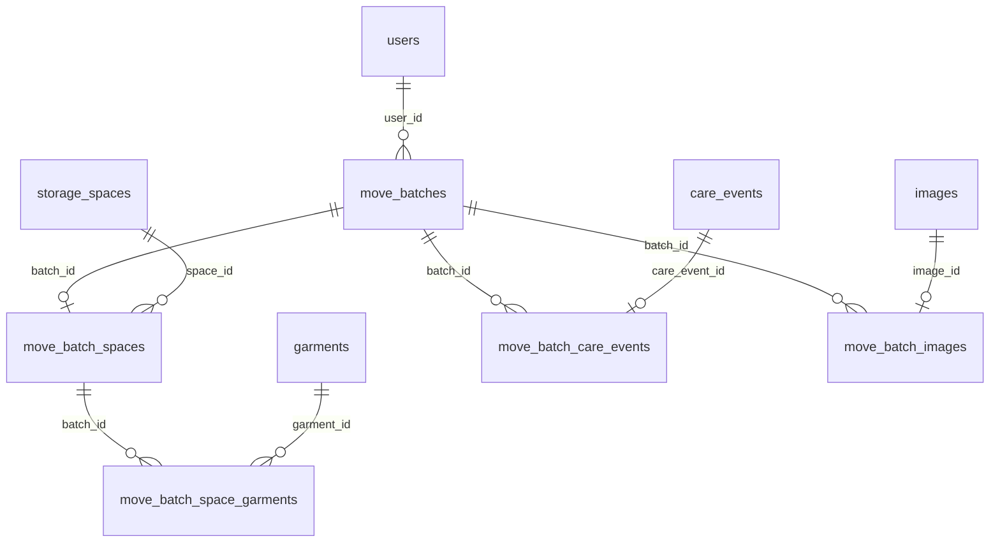

# 옷결 DB 설계: ER 다이어그램과 정규화 검토

- 스키마 원본: [`schema.sql`](schema.sql) (MariaDB 10.4 이상, utf8mb4)
- 테이블 46개(핵심 29 + 도메인 17), 외래키 60개(복합 FK 1개 포함, 열 쌍 61개), CHECK 제약 22개, 같은 주인 트리거 22개
- V2(R11 옮기는 묶음, 2.1절)를 더하면 테이블 51개(핵심 34 + 도메인 17), 외래키 69개(열 쌍 70개), CHECK 22개, 트리거 30개다. V2 개수는 스크립트에서 센 값이고, 실제 적용은 CI의 마이그레이션 테스트로 확인한다. 아래 1~2절 다이어그램과 검증 수치는 V1 기준이다.
- V3(`V3__scope_cleanup.sql`): 범위에서 뺀 코디 테이블 `outfits`·`outfit_garments`·`body_profiles`를 지우고, 옷 ↔ 등록 때 한 제품 검색 연결 `garment_product_searches`(같은 주인 트리거 2개)를 더했다. 그래서 테이블 49개다. 아래 다이어그램의 코디 테이블은 V1 기록으로 남겨 둔다.
- V4(`V4__care_completed_kst.sql`): `care_events.ck_ce_completed`를 `DATE(completed_at + INTERVAL 9 HOUR) >= dropped_on`으로 바꿨다. `completed_at`은 UTC로, `dropped_on`은 서울 날짜로 저장돼 서울 00~09시 회수가 막혔다. 테이블·CHECK 개수는 그대로다.
- 아래 다이어그램은 손으로 그리지 않았다. `schema.sql`을 실제 MariaDB 10.4.12에 적용한 뒤 `information_schema`에서 자동 생성했다. 관계선 41 + 20 = 61개가 외래키 열 쌍 61개와 같다.

## 1. 교차 검증 결과

| 검증 | 방법 | 결과 |
| --- | --- | --- |
| 문법·생성 | 빈 MariaDB 10.4.12 인스턴스에 `schema.sql` 실행 | 오류 0. 테이블 46, FK 60, CHECK 22, 트리거 22 생성 |
| 다이어그램 일치 | ERD를 `information_schema`(columns, key_column_usage, referential_constraints, statistics)에서 생성 | 관계선 61 = FK 열 쌍 61. 테이블·열·PK/FK/UK 표시가 카탈로그와 같음 |
| 제약 동작 | 잘못된 입력 41건을 넣어 **의도한 제약 이름**으로 거부되는지 확인 | 41/41 의도한 제약으로 거부, 정상 입력 4/4 허용 |
| 같은 주인 | 트리거가 걸린 연결 테이블 11개마다 남의 개체를 연결 | 11/11 `owner_mismatch:<테이블>`로 거부(수정 UPDATE 1건 포함 12건) |
| 계산 상태 | 세탁 중·수선 중·회수 후 위치 미확인을 저장하지 않고 조회로 계산 | 보관 중 / 수선 중 / 회수 완료·위치 미확인이 기대대로 계산됨 |
| 정적 규칙 | 세부 종류와 3D 템플릿의 종류가 같은지 조회 | 불일치 0건 |
| 연쇄 삭제 | 회원 1명 삭제 | 그 회원의 옷·공간·세탁 기록·이미지·검색·컬렉션·코디는 모두 삭제, 다른 회원 행은 유지 |
| 독립 검토 | 이 문서를 보지 않은 별도 검토자가 `schema.sql`만 읽고 정규형 판정(2회) | 7절 |

거부를 확인한 입력은 다음과 같다.
- 코드·참조: 없는 계절·세부 종류·치수 부위·섬유 코드, 없는 공간에 배치
- 상태: 세탁 중 상태를 직접 저장
- 값 범위: 빈 옷 이름, 잘못된 색상 코드, 혼용률 0%, 수용 개수 0, 키 20cm, 허용하지 않는 이미지 형식
- 세탁·수선: 회수 예정일이 맡긴 날보다 앞, 진행 중 세탁·수선 2건, 자택인데 업체명 기입
- 택 판독: 실패인데 오류 메시지 없음, 완료인데 오류 메시지 있음
- 중복: 같은 계절, 같은 컬렉션 이름, 같은 이메일 재가입, 같은 검색 안 같은 URL 후보
- 하나만 허용: 한 벌에 확정 위치 2개, 한 벌에 미확정 추천 2개, 한 공간에 상위 공간 2개
- 공간 계층: 자기 자신을 상위 공간으로 지정
- 이미지·제품: 다른 옷이나 연결되지 않은 이미지를 대표로 지정, 같은 후보를 두 옷에 확정, 처리 결과가 원본 자신
- 같은 주인: 남의 공간에 배치·배치 추천, 남의 공간 아래에 내 공간, 남의 코디·컬렉션에 내 옷, 남의 이미지를 내 옷이나 처리 결과에 연결, 남의 판독에 내 택 사진, 남의 판독을 내 옷에, 남의 검색을 내 판독에, 남의 검색 후보를 내 옷에 확정, 배치를 남의 공간으로 수정

## 2. ER 다이어그램: 핵심 테이블 29개

표기: `||` 정확히 하나, `|o` 없거나 하나, `o{` 0개 이상, `o|` 0개 또는 하나. 관계선 이름은 외래키 열이다. `"NULL 허용"`이 없는 열은 NOT NULL이다. `garment_cover_images → garment_images`는 (garment_id, image_id) 복합 FK라 선이 두 개다.

```mermaid
erDiagram
    body_profiles {
        bigint user_id PK, FK
        decimal height_cm "NULL 허용"
        decimal shoulder_cm "NULL 허용"
        decimal chest_cm "NULL 허용"
        decimal waist_cm "NULL 허용"
        decimal hip_cm "NULL 허용"
        decimal inseam_cm "NULL 허용"
    }
    care_events {
        bigint id PK
        bigint garment_id FK
        varchar care_type_code FK
        varchar place_code FK
        varchar shop_name "NULL 허용"
        varchar description "NULL 허용"
        date dropped_on
        date due_on "NULL 허용"
        datetime completed_at "NULL 허용"
        datetime created_at
        bigint ongoing_garment_id UK "NULL 허용"
    }
    collections {
        bigint id PK
        bigint user_id FK
        varchar name
    }
    garment_ai_fields {
        bigint garment_id PK, FK
        varchar field_code PK, FK
    }
    garment_care_instructions {
        bigint garment_id PK, FK
        int line_no PK
        varchar instruction
    }
    garment_collections {
        bigint garment_id PK, FK
        bigint collection_id PK, FK
    }
    garment_cover_images {
        bigint garment_id PK, FK
        bigint image_id FK, UK
    }
    garment_images {
        bigint image_id PK, FK
        bigint garment_id FK
    }
    garment_label_extractions {
        bigint extraction_id PK, FK
        bigint garment_id FK
    }
    garment_materials {
        bigint garment_id PK, FK
        varchar part_code PK, FK
        varchar fiber_code PK, FK
        decimal percent
    }
    garment_measurements {
        bigint garment_id PK, FK
        varchar part_code PK, FK
        varchar kind_code PK, FK
        decimal value_cm
        varchar source "NULL 허용"
        tinyint confirmed
    }
    garment_placements {
        bigint garment_id PK, FK
        bigint space_id FK
        datetime placed_at
    }
    garment_products {
        bigint garment_id PK, FK
        bigint candidate_id FK, UK
        datetime confirmed_at
    }
    garment_seasons {
        bigint garment_id PK, FK
        varchar season_code PK, FK
    }
    garments {
        bigint id PK
        bigint user_id FK
        varchar name
        varchar brand "NULL 허용"
        varchar product_code "NULL 허용"
        varchar color_name "NULL 허용"
        char color_hex "NULL 허용"
        varchar size_label "NULL 허용"
        varchar origin "NULL 허용"
        varchar sub_type_code FK
        varchar wear_frequency_code FK
        varchar status_code FK
        tinyint usable_when_pending
        datetime created_at
        datetime updated_at
    }
    image_processings {
        bigint source_image_id PK, FK
        bigint result_image_id FK, UK "NULL 허용"
        datetime processed_at
    }
    images {
        bigint id PK
        bigint user_id FK
        varchar content_type
        longblob data
        varchar source_url "NULL 허용"
        datetime created_at
    }
    label_extraction_images {
        bigint extraction_id PK, FK
        bigint image_id PK, FK
    }
    label_extraction_searches {
        bigint search_id PK, FK
        bigint extraction_id FK
    }
    label_extraction_values {
        bigint extraction_id PK, FK
        varchar field_code PK, FK
        varchar read_value "NULL 허용"
        varchar corrected_value "NULL 허용"
    }
    label_extractions {
        bigint id PK
        bigint user_id FK
        text raw_text "NULL 허용"
        varchar status_code FK
        varchar error_message "NULL 허용"
        datetime created_at
    }
    outfit_garments {
        bigint outfit_id PK, FK
        bigint garment_id PK, FK
    }
    outfits {
        bigint id PK
        bigint user_id FK
        varchar name
        datetime created_at
    }
    placement_proposals {
        bigint id PK
        bigint garment_id FK, UK
        bigint space_id FK
        varchar reason "NULL 허용"
        datetime created_at
    }
    product_candidates {
        bigint id PK
        bigint search_id FK
        varchar name
        varchar brand "NULL 허용"
        varchar product_code "NULL 허용"
        varchar color_name "NULL 허용"
        varchar image_url "NULL 허용"
        varchar source_url
        varchar match_reason "NULL 허용"
    }
    product_searches {
        bigint id PK
        bigint user_id FK
        varchar query_brand "NULL 허용"
        varchar query_product_code "NULL 허용"
        varchar status_code FK
        datetime searched_at
    }
    storage_space_parents {
        bigint space_id PK, FK
        bigint parent_space_id FK
    }
    storage_spaces {
        bigint id PK
        bigint user_id FK
        varchar name
        varchar space_type_code FK
        int capacity "NULL 허용"
        datetime created_at
    }
    users {
        bigint id PK
        varchar email UK
        varchar password_hash
        datetime created_at
    }
    users ||--o| body_profiles : "user_id"
    garments ||--o{ care_events : "garment_id"
    users ||--o{ collections : "user_id"
    users ||--o{ garments : "user_id"
    garments ||--o{ garment_ai_fields : "garment_id"
    garments ||--o{ garment_care_instructions : "garment_id"
    collections ||--o{ garment_collections : "collection_id"
    garments ||--o{ garment_collections : "garment_id"
    garments ||--o| garment_cover_images : "garment_id"
    garment_images ||--o| garment_cover_images : "image_id"
    garment_images ||--o| garment_cover_images : "garment_id"
    garments ||--o{ garment_images : "garment_id"
    images ||--o| garment_images : "image_id"
    label_extractions ||--o| garment_label_extractions : "extraction_id"
    garments ||--o{ garment_label_extractions : "garment_id"
    garments ||--o{ garment_materials : "garment_id"
    garments ||--o{ garment_measurements : "garment_id"
    garments ||--o| garment_placements : "garment_id"
    storage_spaces ||--o{ garment_placements : "space_id"
    product_candidates ||--o| garment_products : "candidate_id"
    garments ||--o| garment_products : "garment_id"
    garments ||--o{ garment_seasons : "garment_id"
    users ||--o{ images : "user_id"
    images |o--o| image_processings : "result_image_id"
    images ||--o| image_processings : "source_image_id"
    users ||--o{ label_extractions : "user_id"
    label_extractions ||--o{ label_extraction_images : "extraction_id"
    images ||--o{ label_extraction_images : "image_id"
    label_extractions ||--o{ label_extraction_searches : "extraction_id"
    product_searches ||--o| label_extraction_searches : "search_id"
    label_extractions ||--o{ label_extraction_values : "extraction_id"
    users ||--o{ outfits : "user_id"
    garments ||--o{ outfit_garments : "garment_id"
    outfits ||--o{ outfit_garments : "outfit_id"
    garments ||--o| placement_proposals : "garment_id"
    storage_spaces ||--o{ placement_proposals : "space_id"
    product_searches ||--o{ product_candidates : "search_id"
    users ||--o{ product_searches : "user_id"
    users ||--o{ storage_spaces : "user_id"
    storage_spaces ||--o{ storage_space_parents : "parent_space_id"
    storage_spaces ||--o| storage_space_parents : "space_id"
```



## 2.1 옮기는 묶음(R11, V2 마이그레이션) 테이블 5개

옷 여러 벌을 한 번에 박스·집 밖 공간으로 옮기거나 세탁소에 맡긴 기록이다. 공간 유형에 `BOX`(박스)와 `OFFSITE`(집 밖)를 추가했다.

- 묶음 하나는 공간으로 옮긴 것(`move_batch_spaces`)이거나 세탁소에 맡긴 것(`move_batch_care_events`) 중 하나다. 한 테이블에 NULL 허용 열로 두면 NULL FK가 `user_id`를 결정하는 문제(4절 BCNF 항목)가 다시 생겨서 하위 테이블로 나눴다.
- 옷의 현재 위치는 여전히 `garment_placements`가 정한다. 묶음은 '언제 어디로 함께 옮겼는지'와 박스 라벨·영수증 사진(`move_batch_images`)을 남기는 이력이다.
- 세탁소 묶음은 옷마다 `care_events`를 만들고 그 ID를 묶음에 연결한다. 맡긴 곳·회수 예정일은 `care_events`에만 있어서 중복 저장하지 않는다.
- 새 연결 테이블 4개에도 같은 주인 트리거(INSERT/UPDATE 8개)를 걸었다.



## 3. ER 다이어그램: 도메인(코드) 테이블 17개

코드 값의 허용 범위와 한국어 이름이다. 모든 코드 열은 이 테이블을 FK로 참조하므로 정해진 값만 저장된다(1NF의 도메인 조건).

```mermaid
erDiagram
    care_places {
        varchar code PK
        varchar label UK
    }
    care_types {
        varchar code PK
        varchar label UK
        varchar garment_status_code FK, UK
    }
    categories {
        varchar code PK
        varchar label UK
    }
    clothing_templates {
        varchar code PK
        varchar label UK
        varchar category_code FK
    }
    extraction_statuses {
        varchar code PK
        varchar label UK
    }
    fibers {
        varchar code PK
        varchar label UK
    }
    garment_fields {
        varchar code PK
        varchar label UK
    }
    garment_statuses {
        varchar code PK
        varchar label UK
    }
    material_parts {
        varchar code PK
        varchar label UK
    }
    measurement_kinds {
        varchar code PK
        varchar label UK
    }
    measurement_parts {
        varchar code PK
        varchar label UK
    }
    search_statuses {
        varchar code PK
        varchar label UK
    }
    seasons {
        varchar code PK
        varchar label UK
        int sort_order UK
    }
    space_types {
        varchar code PK
        varchar label UK
    }
    sub_type_templates {
        varchar sub_type_code PK, FK
        varchar template_code FK
    }
    sub_types {
        varchar code PK
        varchar label UK
        varchar category_code FK
        int sort_order UK
    }
    wear_frequencies {
        varchar code PK
        varchar label UK
        int sort_order UK
    }
    care_places ||--o{ care_events : "place_code"
    care_types ||--o{ care_events : "care_type_code"
    garment_statuses ||--o| care_types : "garment_status_code"
    categories ||--o{ clothing_templates : "category_code"
    wear_frequencies ||--o{ garments : "wear_frequency_code"
    garment_statuses ||--o{ garments : "status_code"
    sub_types ||--o{ garments : "sub_type_code"
    garment_fields ||--o{ garment_ai_fields : "field_code"
    fibers ||--o{ garment_materials : "fiber_code"
    material_parts ||--o{ garment_materials : "part_code"
    measurement_kinds ||--o{ garment_measurements : "kind_code"
    measurement_parts ||--o{ garment_measurements : "part_code"
    seasons ||--o{ garment_seasons : "season_code"
    extraction_statuses ||--o{ label_extractions : "status_code"
    garment_fields ||--o{ label_extraction_values : "field_code"
    search_statuses ||--o{ product_searches : "status_code"
    space_types ||--o{ storage_spaces : "space_type_code"
    categories ||--o{ sub_types : "category_code"
    sub_types ||--o| sub_type_templates : "sub_type_code"
    clothing_templates ||--o{ sub_type_templates : "template_code"
```



## 4. 도무이결다조: 단계별로 고친 것

기존 초안(V1, 테이블 12개)을 출발점으로, 각 단계에서 무엇이 위반이었고 어떻게 고쳤는지 적는다.

| 단계 | 기존 초안의 위반 | 고친 방법 |
| --- | --- | --- |
| **도** 1NF·도메인 | `garments.ai_fields`, `label_extractions.unread_fields`가 쉼표 목록 | `garment_ai_fields(garment_id, field_code)` 행으로 분리. 미확인 여부는 `label_extraction_values.read_value IS NULL`로 표현 |
| | `extracted_json`, `corrected_json`이 JSON 덩어리 | `label_extraction_values(extraction_id, field_code, read_value, corrected_value)` |
| | `material`에 '겉감 울 70%, 폴리 30% / 안감 …'을 한 칸에 저장 | `garment_materials(garment_id, part_code, fiber_code, percent)`. 섬유는 `fibers` 도메인, 택 원문 표기는 `label_extraction_values`에 보존 |
| | `care_instructions`에 여러 지시를 한 칸에 저장 | `garment_care_instructions(garment_id, line_no, instruction)` |
| | 상태·종류·계절·치수 부위·섬유 등 코드 값이 자유 문자열 | 도메인 테이블 17개와 FK. 값 범위는 CHECK |
| **무** 2NF | 복합 키 테이블의 부분 종속(초안에도 없었음) | 새 복합 키 테이블도 비키 속성이 키 전체에 종속. `percent`는 (옷, 부위, 섬유) 전체에, `value_cm`은 (옷, 부위, 종류) 전체에 종속 |
| **이** 3NF | `garments`: `id → sub_type → category` | `category` 열 삭제. `sub_types.category_code`에서 계산 |
| | `garments.space_id → user_id`(같은 주인 규칙 때문에 공간이 옷의 주인을 결정, `space_id`는 키가 아님) | 확정 위치를 `garment_placements(garment_id, space_id, placed_at)`로 분리하고 같은 주인 규칙은 트리거로 강제 |
| | `garments.representative_image_id → user_id` | `garment_cover_images(garment_id, image_id)` |
| | `storage_spaces.parent_id → user_id` | `storage_space_parents(space_id, parent_space_id)`. 각 테이블은 BCNF를 유지하고 같은 주인 규칙은 트리거로 강제 |
| | `care_events`, `placement_proposals`, `outfits`의 `garment_id`·`top_id → user_id` | 해당 테이블에서 `user_id` 삭제. 소유자는 의류를 거쳐 판단 |
| | NULL 허용 FK가 `user_id`를 결정: `image_assets.garment_id`, `label_extractions.garment_id`, `product_candidates.garment_id` | `garment_images`, `garment_label_extractions`, `garment_products` 연결 테이블로 분리 |
| | `sub_types`에 `template_code`를 두면 `template_code → category_code` | `sub_type_templates(sub_type_code, template_code)`로 분리 |
| **결** BCNF | 코디를 `(outfit_id, role) → garment_id`로 두면 `garment_id → role`이 결정자인데 후보 키가 아님 | `outfit_garments(outfit_id, garment_id)`만 저장. 상의·하의 역할은 의류의 세부 종류에서 계산 |
| | 도메인 테이블에서 `code`와 `label`(과 `sort_order`)이 서로를 결정 | 모두 UNIQUE로 선언해 결정자 = 후보 키 |
| **다** 4NF | 계절·컬렉션·AI 필드를 한 테이블에 두면 서로 독립인 다치 종속이 곱으로 저장됨 | `garment_seasons`, `garment_collections`, `garment_ai_fields`를 각각 분리 |
| | 택 판독의 사진 목록과 항목 값 | `label_extraction_images`와 `label_extraction_values`로 분리 |
| **조** 5NF | 3열 이상 전부-키(all-key) 테이블 없음 | 키가 3열인 `garment_materials`, `garment_measurements`는 비키 속성이 키 전체에 종속해서 더 쪼개면 정보가 사라짐(무손실 분해 불가). 2열 연결 테이블은 정의상 5NF |
| 중복 제거 | 계산할 수 있는 값을 저장(정규형 위반은 아니지만 갱신 이상의 원인) | 독립 검토 지적을 반영해 아래 열을 삭제하고 계산(5절): 처리 성공 여부, 후보 있음, 세탁 중·수선 중·회수 후 위치 미확인, `is_away`, 이미지 종류, `length_cm`, 추천 `applied_at` |

## 5. 저장하지 않고 계산하는 값

| 화면에 보이는 값 | 계산 방법 |
| --- | --- |
| 옷 종류(상의·하의 등) | `garments.sub_type_code → sub_types.category_code` |
| 3D 템플릿 / '3D 미지원' | `sub_type_templates`에 행이 있는지 |
| 현재 상태 | ① 진행 중 `care_events`가 있으면 `care_types.garment_status_code`(세탁 중·수선 중) ② 최근 `completed_at`이 `garment_placements.placed_at`보다 나중이거나 위치가 없으면 '회수 완료·위치 미확인' ③ 그 밖에는 `garments.status_code`(보관 중, 착용·보관 전, 세탁 대기) |
| 집에 없는 옷인지 | 현재 상태가 `care_types.garment_status_code`에 있는지 |
| 위치 경로 '옷장 A → 왼쪽 행거' | `garment_placements → storage_spaces → storage_space_parents`를 따라 올라감 |
| 미배치 | `garment_placements`에 행이 없음('보관 중'이면서 행이 없으면 집에 있지만 위치를 정하지 않은 옷) |
| 옷 길이(3D) | `garment_measurements`의 (`TOTAL_LENGTH`, `LENGTH`) 행 |
| 이미지 종류 | `label_extraction_images`에 있으면 택 사진, `image_processings.result_image_id`이면 정리된 대표 이미지, `source_url`이 있으면 제품 이미지 원본, 그 밖에는 직접 찍은 옷 사진 |
| 택 항목 '확인 필요' | `label_extraction_values.read_value IS NULL` |
| 검색 결과 없음 | `product_searches.status_code = 'SUCCEEDED'`이고 후보 0개 |
| 이미지 정리 실패 | `image_processings.result_image_id IS NULL` |
| 오늘 회수 예정·기한 지남 | 진행 중 기록의 `due_on`을 조회 시점 날짜와 비교 |

검증에 쓴 상태 계산 조회:

```sql
SELECT g.name,
  CASE WHEN oc.id IS NOT NULL THEN ct.garment_status_code
       WHEN lc.last_done IS NOT NULL AND (gp.placed_at IS NULL OR lc.last_done > gp.placed_at) THEN 'RETURNED_UNPLACED'
       ELSE g.status_code END AS effective_status,
  CONCAT_WS(' → ', parent.name, sp.name) AS path
FROM garments g
LEFT JOIN care_events oc ON oc.garment_id = g.id AND oc.completed_at IS NULL
LEFT JOIN care_types ct ON ct.code = oc.care_type_code
LEFT JOIN (SELECT garment_id, MAX(completed_at) last_done FROM care_events
           WHERE completed_at IS NOT NULL GROUP BY garment_id) lc ON lc.garment_id = g.id
LEFT JOIN garment_placements gp ON gp.garment_id = g.id
LEFT JOIN storage_spaces sp ON sp.id = gp.space_id
LEFT JOIN storage_space_parents p ON p.space_id = sp.id
LEFT JOIN storage_spaces parent ON parent.id = p.parent_space_id;
```

## 6. 무결성 규칙과 강제 위치

정규화는 한 테이블 안의 종속을 다룬다. 아래는 행이나 테이블에 걸친 규칙이다.

| 규칙 | 강제 위치 |
| --- | --- |
| 진행 중인 세탁·수선은 한 벌에 하나 | DB: 가상 열 `ongoing_garment_id` + `uk_ce_one_ongoing` |
| 대표 이미지는 그 옷에 연결된 이미지 | DB: 복합 FK `fk_gcover_own_image` |
| 업체명은 맡긴 곳이 업체일 때만 | DB: `ck_ce_shop` |
| 판독 실패일 때만 오류 메시지 | DB: `ck_le_error` |
| 미확정 배치 추천은 한 벌에 하나 | DB: `uk_pp_garment` |
| 연결되는 두 개체의 주인이 같아야 함(내 옷을 남의 공간에 배치 불가 등) | DB: 연결 테이블 11개의 BEFORE INSERT/UPDATE 트리거 22개(`owner_mismatch:<테이블>`). 연결 테이블에 `user_id`를 다시 저장하는 복합 FK 방식은 (FK → user_id) 종속으로 BCNF를 깨므로 택하지 않음. 서버도 연결 전에 두 개체를 로그인 사용자 ID로 조회(남의 것은 404) |
| 공간 계층에 순환이 없음 | 서버: 상위 공간 지정 시 조상을 따라 올라가며 확인 |
| 안쪽 공간이 있는 공간은 삭제 불가(지우면 안쪽 공간이 최상위로 바뀜) | 서버: 삭제 전에 확인 |
| 검색 기록은 개별 삭제하지 않음(확정 제품 보존) | 서버: 검색 삭제 API 없음. 회원 탈퇴 때만 함께 삭제 |
| 코디는 상의(상의·아우터) 1벌과 하의 1벌 | 서버: 저장 전에 세부 종류의 종류로 확인 |
| 소재 부위별 혼용률 합계 100% | 서버: 택 판독값 정정 화면에서 확인 |
| 검색 실패에는 후보가 없음 | 서버: 실패 시 후보를 저장하지 않음 |
| 사용자 수정값은 AI 재분석으로 덮어쓰지 않음 | 서버: `garment_ai_fields`에 있는 항목만 AI 값으로 갱신 |
| 세부 종류와 템플릿의 종류가 같음 | 고정 도메인 값. 1절의 조회로 확인(불일치 0) |

## 7. 독립 검토 결과

이 설계를 만들지 않은 별도 검토자가 `schema.sql`만 읽고 판정했다.

**1차 검토**: 모든 테이블이 단독으로는 BCNF·4NF·5NF를 만족한다고 판정했다. 대신 테이블 사이의 중복과 강제되지 않는 규칙을 지적했다.

| 지적 | 처리 |
| --- | --- |
| B1 `garment_statuses.is_away`가 `care_types`에서 계산됨 | 반영: 열 삭제 |
| B2 `garments.length_cm`와 치수 테이블 중복, 치수 부위가 자유 문자열 | 반영: `length_cm` 삭제, `measurement_parts` 도메인 추가 |
| B2 브랜드·품번이 확정 후보와 중복 | 설명 추가: `garments` 값은 사용자 확정값, 후보는 검색 당시 웹페이지 기록(서로 다른 사실) |
| B3 `images.kind_code`가 연결 테이블에서 계산됨 | 반영: 열과 `image_kinds` 삭제 |
| B4 결과 이미지 삭제 시 SET NULL이 '실패'로 바뀜 | 반영: CASCADE |
| C1 같은 주인 규칙이 강제되지 않음 | 반영: 대표 이미지는 복합 FK, 나머지 11개 연결은 트리거(2차 검토의 제안). `user_id` 중복 저장 방식은 BCNF를 깨므로 택하지 않음 |
| C2 진행 중 세탁 1건, 업체명, 오류 메시지, 혼용률 합계, 실패 검색의 후보 | 앞의 세 개는 DB 제약으로 반영, 나머지 두 개는 서버 |
| C3 컬렉션이 개체가 아님 | 반영: `collections` 테이블 |
| `product_candidates` 중복 후보 가능 | 반영: `UNIQUE(search_id, source_url)` |
| D1 문자셋 미지정 | 반영: DB를 utf8mb4로 만들도록 명시(compose와 README) |
| D2 회원 삭제 시 RESTRICT로 실패할 수 있음 | 반영: CASCADE, 연쇄 삭제 확인 |
| `placement_proposals.applied_at`이 `placed_at`과 겹침 | 반영: 적용된 추천은 삭제, 한 벌에 미확정 추천 하나 |

**2차 검토(수정본)**

검토자 결론: 채택한 수정이 모두 올바르게 구현되었고 새 정규형 위반이나 중복은 없다.

| 추가 지적 | 처리 |
| --- | --- |
| CASCADE FK 열에서 파생된 인덱스 가상 열(`ongoing_garment_id`)은 MariaDB에서 문제가 생긴 적이 있음 | 반영: `PERSISTENT`로 변경, 회원 탈퇴 연쇄 삭제 재확인 |
| 같은 주인 규칙을 `user_id` 중복 없이 강제하려면 트리거 사용 | 반영: 트리거 22개, 11개 연결 테이블 모두 거부 테스트 통과 |
| 주석이 '이행 종속 제거'라고 쓴 것은 부정확함(분할은 BCNF 유지, 같은 주인 규칙은 별도 강제) | 반영: 주석과 4절 문구 수정 |
| 문자셋이 주석에만 있음 | 반영: 모든 테이블에 `ENGINE=InnoDB DEFAULT CHARSET=utf8mb4 COLLATE=utf8mb4_unicode_ci` |
| `garment_materials.fiber`가 자유 문자열 | 반영: `fibers` 도메인과 FK |
| 바깥 공간 삭제 시 안쪽 공간이 조용히 최상위가 됨 | 서버가 삭제 거부(6절) |
| 보관 중인데 위치 행이 없는 조합의 의미 | '미배치'로 정의(5절) |
| 검색 삭제 시 확정 제품이 함께 삭제됨 | 검색 개별 삭제 없음으로 정의(6절) |
| 혼용률 합계 100%, 실패 검색의 후보 없음 | 여러 행에 걸친 규칙이라 서버에서 확인(6절) |

## 8. 다시 검증하는 방법

```bash
# 1) 빈 DB에 스키마 적용
mysql -u root -e "CREATE DATABASE otgyeol_check CHARACTER SET utf8mb4 COLLATE utf8mb4_unicode_ci"
mysql -u root otgyeol_check < docs/db/schema.sql
# 2) 개수 확인: 46 / 60 / 22 / 22
mysql -u root -N -e "SELECT COUNT(*) FROM information_schema.tables WHERE table_schema='otgyeol_check';
  SELECT COUNT(*) FROM information_schema.referential_constraints WHERE constraint_schema='otgyeol_check';
  SELECT COUNT(*) FROM information_schema.check_constraints WHERE constraint_schema='otgyeol_check';
  SELECT COUNT(*) FROM information_schema.triggers WHERE trigger_schema='otgyeol_check';"
```
